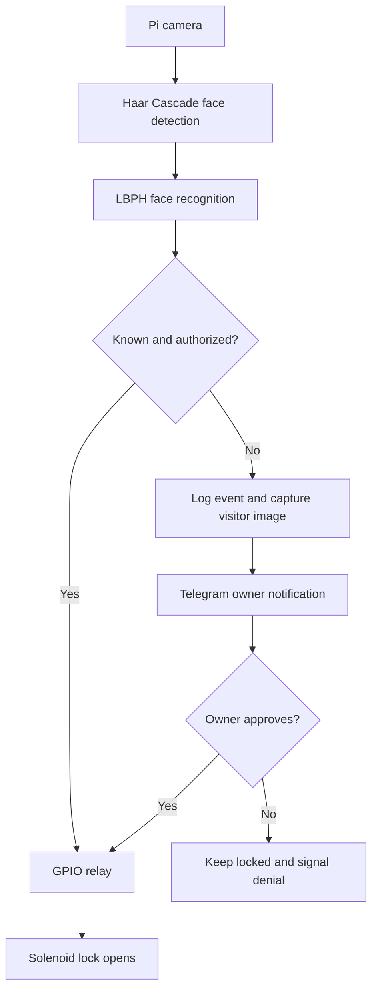

# Intelligent Multi-Cabin Access System

**Academic team project | Raspberry Pi · Python · OpenCV · Haar Cascade · LBPH · Telegram Bot API**

An embedded access-control prototype that recognizes authorized users and operates an electronic cabin lock. An unknown visitor triggers a photo alert sent to the cabin owner over Telegram, allowing remote approval or denial.

> **Repository status:** Documented project case study. The original runnable Raspberry Pi source code has not been supplied for public publication; this repository does not claim to contain it.

## Main features
- Live face detection with Haar Cascade and face recognition with Local Binary Patterns Histograms (LBPH)
- Raspberry Pi-driven relay and solenoid lock for authorized access
- Telegram alert with visitor image and owner approval/denial for unknown faces
- LCD/buzzer access feedback and event logging
- A design intended to support more than one cabin from a controller

## System architecture

## Technology stack

| Category | Technology |
| --- | --- |
| Controller | Raspberry Pi |
| Programming and vision | Python, OpenCV |
| Face detection | Haar Cascade |
| Face recognition | LBPH |
| Physical access | GPIO, relay module, solenoid lock |
| Notifications | Telegram Bot API |
| Feedback | LCD screen and buzzer |

## Project evidence and status
The accompanying team research manuscript reports a working hardware prototype, real-time face recognition and Telegram owner alerts. The project photographs supplied separately show code running in the Thonny environment, face detection and recognition demonstrations, the wired prototype and Telegram conversations. This repository intentionally excludes biometric face datasets, unredacted screenshots, and live credentials.

**Source code not yet published.** This README documents the completed academic project, not a newly invented implementation. See [the detailed case study](docs/PROJECT_CASE_STUDY.md).

## Security and privacy
- A development screenshot supplied with this project reveals a Telegram bot token. **Revoke that bot token using BotFather and generate a new one before using the bot again.**
- Do not upload people's facial photos, biometric samples, chat IDs, or unredacted access-control screenshots without appropriate permission.
- Facial recognition requires testing against spoofing, false recognition, low light and power failures before any real security deployment.
- The research paper discusses performance qualitatively; this repository does not claim verified production-grade accuracy.

## Team credits
**Shravya U Shetty** — portfolio author and academic project contributor, Acharya Institute of Technology, Bengaluru. Developed as a collaborative student team project with faculty guidance.

## Documentation
Academic manuscript: *Intelligent Multicabin Access System Using Face Recognition* (team-provided, seven pages). The original manuscript is not republished here pending clearance to redistribute its full text and images.

## Additional implementation context

See [Implementation details and Shravya's reported contributions](docs/IMPLEMENTATION_DETAILS.md), prepared from the team research manuscript and the newly supplied interview notes. Original face datasets and unredacted photos remain unpublished.
